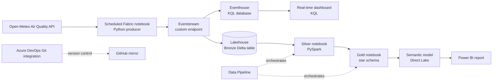

# Real-Time Air Quality Monitoring Platform on Microsoft Fabric

An end-to-end data engineering project that ingests hourly air quality data for six Indian cities, streams it into Microsoft Fabric, and serves it through two paths: a **real-time dashboard** for what is happening now, and a **medallion (Bronze / Silver / Gold) model with a Power BI report** for history and trends. The Fabric workspace is Git-integrated with Azure DevOps and mirrored to GitHub.

## Architecture



**Hot path (real time):** API → Eventstream → Eventhouse → KQL real-time dashboard
**Cold path (history):** API → Eventstream → Bronze → Silver → Gold → semantic model → Power BI

## Tech stack

Microsoft Fabric (Eventstream, Eventhouse, Lakehouse, Notebooks, Data Pipeline, Real-Time Dashboard), Python, PySpark, Delta Lake, KQL, DAX, Power BI (Direct Lake), Azure DevOps, GitHub

## What was built

| Component | Description |
|---|---|
| **Producer notebook** | A scheduled Fabric notebook polls the Open-Meteo air quality API for six cities (Chennai, Delhi, Mumbai, Bengaluru, Kolkata, Hyderabad) and sends JSON events to the Eventstream custom endpoint (Event Hubs-compatible). |
| **Eventstream** | One stream with two destinations: the Eventhouse (hot path) and a Lakehouse Bronze table (cold path). |
| **Bronze** | Raw events kept exactly as received, so Silver and Gold can always be rebuilt. |
| **Silver** | PySpark notebook: type casting, validation rules, a rejects table for bad rows, deduplication on `(city, observation_time)`, idempotent Delta `MERGE`, and an audit log of each run. |
| **Gold** | PySpark notebook: star schema with three dimensions (`dim_city`, `dim_date`, `dim_aqi_category`) and two facts (`fact_air_quality_hourly`, `fact_air_quality_daily`), with key-integrity checks that fail the run if they break. |
| **Data Pipeline** | Fabric pipeline that runs the Silver and Gold notebooks in order. |
| **Real-time dashboard** | KQL dashboard on the Eventhouse showing current air quality by city, built on the queries in [`kql/dashboard_queries.kql`](kql/dashboard_queries.kql). |
| **Semantic model** | Direct Lake semantic model over the Gold tables with five many-to-one relationships, a marked date table, sorted AQI categories, hidden technical keys and DAX measures. Full definition in [`semantic_model/model_definition.md`](semantic_model/model_definition.md). |
| **Power BI report** | Report with KPI cards, a trend line chart, a city comparison and slicers. Values were reconciled against the Silver table. |
| **Version control** | The Fabric workspace is connected to an Azure DevOps repository, and workspace items are committed there. The repository is mirrored to this GitHub repo. |

## Screenshots

| | |
|---|---|
| Eventstream with both destinations active |  |
| Semantic model relationships |  |
| Power BI report |  |
| Real-time dashboard |  |

## Key design decisions

| Decision | Reason |
|---|---|
| Python producer notebook | Eventstream cannot call a REST API by itself, so a small producer fetches the data and publishes it. |
| Scheduled notebook instead of Azure Functions | The Azure free-trial plan offered only a Windows Consumption Function App, which does not run Python. A scheduled Fabric notebook was the practical choice. |
| Hot and cold paths from one stream | The Eventhouse answers "what is happening now"; the Lakehouse keeps full history for modelling. One ingestion path feeds both. |
| Raw Bronze layer | No transformation is applied before storage, so any downstream mistake can be corrected by rebuilding. |
| Deduplicate on `(city, observation_time)` | The source updates about once an hour, so repeated polling returns the same reading. |
| Rejects table instead of silently dropping rows | Bad data stays visible and can be inspected. |
| `MERGE` for Silver | Re-running the job gives the same result (idempotent), so retries are safe. |
| Star schema for Gold | Simple, fast and unambiguous for Power BI. |
| Full rebuild of Gold from Silver | The data volume is small, and a full rebuild is always consistent. |
| Direct Lake | The report reads Delta files directly, with no import copy. |
| Azure DevOps Git integration | Workspace items are versioned and recoverable, and the repo is mirrored to GitHub for visibility. |

## Data notes

- Source: [Open-Meteo Air Quality API](https://open-meteo.com/en/docs/air-quality-api). Values are model-based estimates, not ground-sensor readings.
- The source refreshes roughly **hourly**, so the pipeline runs on a similar cadence.
- All timestamps are **UTC**.
- Secrets are never committed to the repository.

## Operational notes

- Capacity planning matters on a trial capacity. A continuously running Eventstream, an Eventhouse and hourly Spark jobs consume a shared pool, so schedules carry end dates and the Eventstream is deactivated when not in use.
- Workspace items are committed to Git regularly, so any item can be restored from version control.

## Future enhancements

- Activator alert for high PM2.5 values
- Historical backfill notebook for longer trend analysis
- Pipeline retries, failure notifications and a semantic model refresh step
- Dev to Prod deployment pipeline

## Repository structure

```
├── README.md
├── fabric/                      Fabric workspace items (Azure DevOps Git integration)
├── notebooks/
│   ├── nb_air_quality_producer.py
│   ├── nb_silver_air_quality.py
│   └── nb_gold_air_quality.py
├── pipeline/
│   └── medallion_architecture_pipeline.json
├── kql/
│   └── dashboard_queries.kql
├── semantic_model/
│   └── model_definition.md
└── docs/
    └── screenshots/
```

## Author

Dharsana | [GitHub](https://github.com/dharsana2025)
